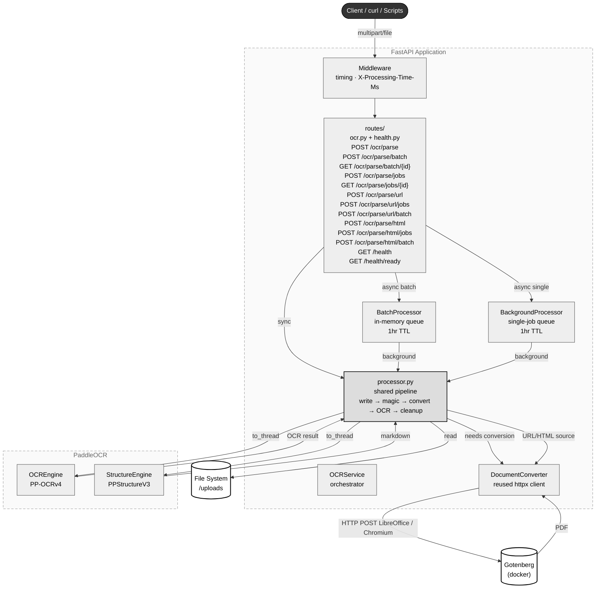

# Exist OCR Service

Internal OCR service for **Exist Software Labs**. Uses [PaddleOCR](https://github.com/PaddlePaddle/PaddleOCR) (PP-OCRv4) to extract text and bounding boxes from uploaded images, PDFs, office documents, URLs, and HTML pages.

> **Status: Heavy Development & Testing** — API, architecture, and features are subject to change.

## Tech Stack

- **Python** 3.11+ / **FastAPI** / **uv**
- **PaddleOCR** (PP-OCRv4) — OCR + structure recognition
- **pydantic-settings** — env config
- **aiofiles** — async file I/O
- **python-magic** — MIME type validation
- **Gotenberg** — document-to-PDF conversion via LibreOffice + Chromium (reused httpx client)
- **Docker** — multi-stage containerized deployment
- **CORS** — `allow_origins=["*"]` for internal demo access
- **Static Files** — `/assets` serves markdown images from OCR output

## Prerequisites

- **Python** 3.11+
- **uv** — `curl -LsSf https://astral.sh/uv/install.sh | sh`
- **System libraries** — see [Prerequisites doc](docs/prerequisites.md) for per-OS breakdown
- **Gotenberg** (optional, for office docs + URL/HTML conversion) — `docker run --rm -p 3000:3000 gotenberg/gotenberg:8`

## Installation

```bash
# Clone
git clone <repo-url>
cd exist-ocr

# Install system deps (Ubuntu/Debian)
sudo apt-get update && sudo apt-get install -y \
  libmagic1 libgl1 libglib2.0-0 libsm6 libxext6 \
  libxrender1 libgomp1 libstdc++6 libc6 curl poppler-utils

# Install Python deps
uv sync

# Start Gotenberg (for office doc + URL/HTML conversion)
docker run -d --rm -p 3000:3000 --name gotenberg gotenberg/gotenberg:8

# Start dev server
uv run fastapi dev app/main.py --port 8000
```

Server at `http://localhost:8000`. API docs at `http://localhost:8000/docs`.

## Supported Files

Three input source types: **File** (upload), **URL** (fetch), and **HTML** (upload + assets). All three support JSON, Markdown, and XML output.

### Source Types

| Source Type | Formats | Pipeline |
|---|---|---|
| **File** (upload) | JPEG, PNG, BMP, TIFF, WebP, PDF, DOC, DOCX, PPT, PPTX, RTF, CSV, XLS, XLSX | Direct OCR, or Gotenberg LibreOffice → PDF → OCR |
| **URL** | Any public URL | Gotenberg Chromium → PDF → OCR |
| **HTML** | `index.html` + optional assets (CSS, JS, images) | Gotenberg Chromium → PDF → OCR |

### File Upload — Full Format Table

| Category | MIME Type | Format |
|---|---|---|
| Image | `image/jpeg` | JPEG |
| Image | `image/png` | PNG |
| Image | `image/bmp` | BMP |
| Image | `image/tiff` | TIFF |
| Image | `image/webp` | WebP |
| Document | `application/pdf` | PDF |
| Document | `application/msword` | DOC |
| Document | `application/vnd.openxmlformats-officedocument.wordprocessingml.document` | DOCX |
| Presentation | `application/vnd.ms-powerpoint` | PPT |
| Presentation | `application/vnd.openxmlformats-officedocument.presentationml.presentation` | PPTX |
| Document | `text/rtf` | RTF |
| Spreadsheet | `text/csv` | CSV |
| Spreadsheet | `application/vnd.ms-excel` | XLS |
| Spreadsheet | `application/vnd.openxmlformats-officedocument.spreadsheetml.sheet` | XLSX |

> **⚠️ Gotenberg required** for: office documents (DOC, DOCX, PPT, PPTX, RTF, CSV, XLS, XLSX), URL sources, and HTML sources. Image and PDF uploads work without Gotenberg.

## Output Formats

All source types support three output formats:
- **JSON** — structured OCR data with per-word bounding boxes, confidence scores, page image URLs
- **Markdown** — extracted text with embedded images served under `/assets/imgs/`
- **XML** — same data as JSON, formatted as pretty-printed XML string

## Architecture



## Documentation

| Topic | Description |
|---|---|
| [Quick Start](docs/quickstart.md) | Prerequisites, local run, docker-compose, make |
| [Prerequisites](docs/prerequisites.md) | System dependencies (apt, brew, uv, Gotenberg) |
| [Configuration](docs/configuration.md) | Environment variables table |
| [API Reference](docs/api.md) | All endpoints (file, URL, HTML) with curl examples and responses (JSON, Markdown, XML) |
| [Testing Scripts](docs/scripts.md) | Scripts table and usage examples |
| [Project Structure](docs/structure.md) | Directory layout |
| [Demo Frontend](index.html) | Standalone UI — drag-and-drop, 3 source types (File/URL/HTML), 3 modes, markdown/XML preview |
| [Makefile](Makefile) | Common task automation (dev, Docker, scripts) |
