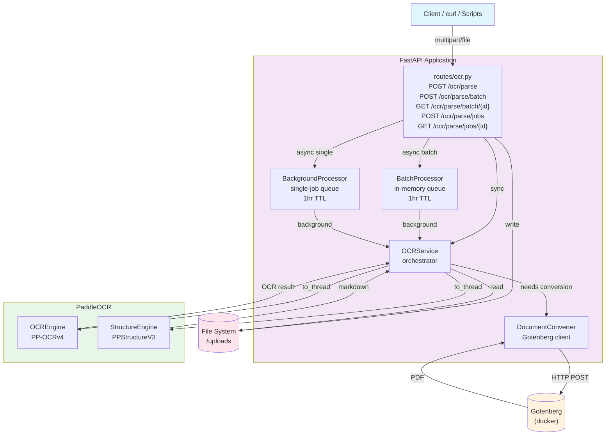

# Exist OCR Service

Internal OCR service for **Exist Software Labs**. Uses [PaddleOCR](https://github.com/PaddlePaddle/PaddleOCR) (PP-OCRv4) to extract text and bounding boxes from uploaded images, PDFs, and office documents.

> **Status: Heavy Development & Testing** — API, architecture, and features are subject to change.

## Tech Stack

- **Python** 3.11+ / **FastAPI** / **uv**
- **PaddleOCR** (PP-OCRv4) — OCR + structure recognition
- **pydantic-settings** — env config
- **aiofiles** — async file I/O
- **python-magic** — MIME type validation
- **Gotenberg** — document-to-PDF conversion
- **Docker** — containerized deployment

## Architecture

## Documentation

| Topic | Description |
|---|---|
| [Quick Start](docs/quickstart.md) | Prerequisites, local run, docker-compose |
| [Configuration](docs/configuration.md) | Environment variables table |
| [API Reference](docs/api.md) | All endpoints with curl examples and responses |
| [Testing Scripts](docs/scripts.md) | Scripts table and usage examples |
| [Project Structure](docs/structure.md) | Directory layout |
