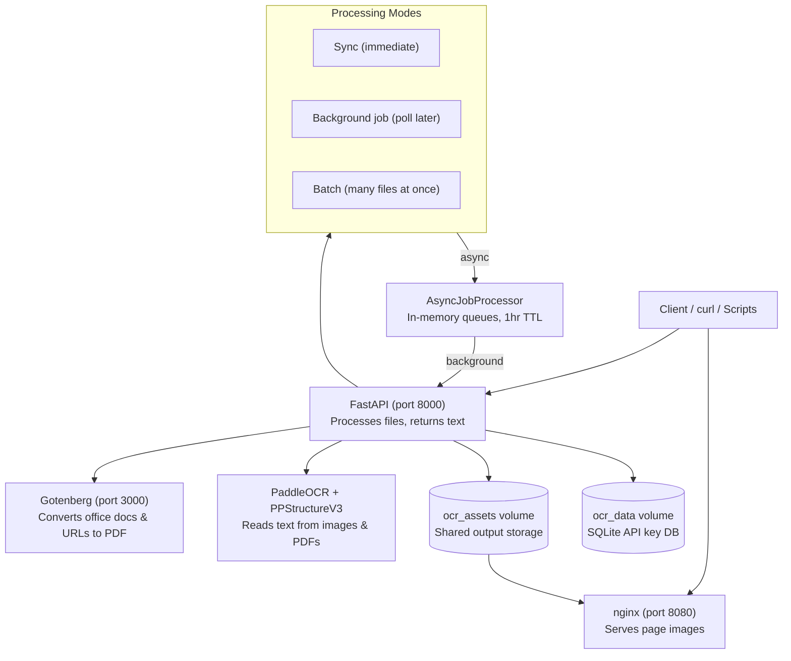

# Exist OCR Service

Internal OCR (Optical Character Recognition) service for **Exist Software Labs**. Takes images, PDFs, office documents, URLs, and HTML pages — extracts the text out of them.

Uses [PaddleOCR](https://github.com/PaddlePaddle/PaddleOCR) (PP-OCRv4), the open-source OCR engine from Baidu. Designed to run on your own infrastructure so documents never leave your network.

> **Status: Beta** — API and core features are stable. Active development in progress.

---

## Key Features

- **Multiple input types** — images, PDFs, Word, Excel, PowerPoint, CSV, RTF, web URLs, HTML files
- **Three processing modes** — synchronous (wait for result), background job (poll later), batch (many files at once)
- **Three output formats** — JSON (structured with word positions), Markdown (formatted text), XML (machine-readable)
- **Privacy-first** — runs on your own infrastructure, no data sent to third parties
- **No per-document costs** — pay for the server once, process unlimited documents
- **API key authentication** — database-backed with secure SHA-256 hashing
- **SSRF protection** — URL endpoints block internal network addresses
- **Auto-cleanup** — output files expire after 1 hour (configurable)
- **Docker Compose** — single-command deployment with Gotenberg + nginx

---

## Quick Start

### Docker Compose (Recommended)

```bash
git clone <repo-url>
cd exist-ocr
cp .env.example .env
# Edit .env — at minimum set OCR_API_KEYS

docker compose up -d
```

| Service | URL | What It Does |
|---|---|---|
| OCR API | `http://localhost:8000` | Process files, return extracted text |
| nginx | `http://localhost:8080` | Serve page images from OCR output |
| Gotenberg | `http://localhost:3000` | Convert office docs to PDF |
| API docs | `http://localhost:8000/docs` | Interactive Swagger UI |

```bash
# Test it
curl -X POST http://localhost:8000/ocr/parse \
  -H "X-API-Key: sk-local-dev" \
  -F "file=@document.pdf"
```

### Local Development

```bash
# System deps (Ubuntu/Debian)
sudo apt-get install -y libmagic1 libgl1 libglib2.0-0 libsm6 libxext6 \
  libxrender1 libgomp1 libstdc++6 libc6 curl poppler-utils

# Python deps
uv sync

# Gotenberg (for office docs, URLs, HTML)
docker run -d --rm -p 3000:3000 --name gotenberg gotenberg/gotenberg:8

# Dev server with hot reload
uv run fastapi dev app/main.py --port 8000
```

### Makefile

| Command | What It Does |
|---|---|
| `make up` | Start all Docker services |
| `make down` | Stop all Docker services |
| `make logs` | Follow logs from all services |
| `make dev` | Start dev server with hot reload |
| `make test` | Run unit tests |
| `make health` | Check API liveness + readiness |
| `make rebuild` | Clean rebuild (down → build → up) |

---

## Architecture



Three services run in Docker containers:

- **FastAPI** (the OCR application) — receives uploads, validates files, runs PaddleOCR, returns results
- **Gotenberg** (document converter) — wraps LibreOffice + Chromium to convert office docs, URLs, and HTML to PDF
- **nginx** (image server) — serves page images from a shared volume so the API stays focused on processing

---

## Supported Files

| Source | Formats | Needs Gotenberg? |
|---|---|---|
| File upload | PNG, JPG, BMP, TIFF, WebP, PDF | No (images/PDF only) |
| File upload | DOC, DOCX, PPT, PPTX, RTF, CSV, XLS, XLSX | Yes |
| URL | Any public web page | Yes |
| HTML | `index.html` + optional CSS/JS/images | Yes |

---

## Processing Modes

| Mode | Endpoint | Use Case |
|---|---|---|
| **Sync** | `POST /ocr/parse` | One file, need result immediately |
| **Background job** | `POST /ocr/parse/jobs` | One file, don't want to wait |
| **Batch** | `POST /ocr/parse/batch` | Many files at once |

Each URL and HTML source has its own sync, job, and batch variant:
`/ocr/parse/url`, `/ocr/parse/url/jobs`, `/ocr/parse/url/batch`, `/ocr/parse/html`, `/ocr/parse/html/jobs`, `/ocr/parse/html/batch`.

---

## Output Formats

| Format | What You Get |
|---|---|
| **JSON** | Every word, its position on the page (bounding box), confidence score, page image URL |
| **Markdown** | Formatted text with tables, headings, embedded images |
| **XML** | Same data as JSON in XML structure for integration with other tools |

---

## Authentication

Three modes:

| Mode | Setup | Key Storage |
|---|---|---|
| **Disabled** | Default (`OCR_API_KEYS=#`) | None |
| **Environment variable** | Keys in `.env` | Plaintext, restart to change |
| **SQLite database** (recommended) | `OCR_DB_PATH=app/data/ocr.db` | SHA-256 hashes, no restart |

```bash
uv run python scripts/create_api_key.py --name alice --team engineering --db-path app/data/ocr.db
# → sk_live_AbCdEfGhIjKlMnOp
```

All POST endpoints and GET job/batch endpoints require the `X-API-Key` header when auth is enabled. Health endpoints are always open.

---

## Security

- **SSRF protection** — URL endpoints block localhost, private IPs, and bad schemes
- **File validation** — MIME type checked twice (header + content sniffing via libmagic)
- **Filename sanitization** — path traversal prevented via `Path(filename).name`
- **Auto-cleanup** — uploaded files deleted after processing, output files expire after 1 hour
- **Concurrency limit** — max 2 simultaneous PaddleOCR calls (configurable, protects against memory issues)

---

## Documentation

### Technical

| Topic | Description |
|---|---|
| [Architecture Overview](kb/tech/01-overview.md) | Services, data flow, Mermaid diagram |
| [Quick Start](kb/tech/02-quickstart.md) | Docker, local dev, Makefile, demo UI |
| [API Reference](kb/tech/03-api.md) | All endpoints with curl examples and response formats |
| [Configuration](kb/tech/04-configuration.md) | Environment variables table |
| [Deployment Guide](kb/tech/05-deployment.md) | Docker, Azure VM, systemd, backups |
| [Prerequisites](kb/tech/06-prerequisites.md) | System dependencies (apt, brew, uv, Gotenberg) |
| [Testing Scripts](kb/tech/07-scripts.md) | Scripts table and usage examples |
| [Project Structure](kb/tech/08-structure.md) | Directory layout |
| [Troubleshooting](kb/tech/09-troubleshooting.md) | Common errors and fixes |

### User Guide (non-technical)

| Topic | Description |
|---|---|
| [What Is This?](kb/user-guide/01-what-is-this.md) | Plain English overview with analogies |
| [Getting Started](kb/user-guide/02-getting-started.md) | Web UI, curl, Python/JS examples |
| [Understanding Results](kb/user-guide/03-understanding-results.md) | How to read JSON, Markdown, XML output |
| [FAQ](kb/user-guide/04-faq.md) | Common questions |

### Other

| File | Description |
|---|---|
| [Demo Frontend](index.html) | Standalone drag-and-drop UI, 3 source types, 3 modes, visualize bbox overlays |
| [Makefile](Makefile) | Task automation (dev, Docker, scripts) |
| [.env.example](.env.example) | Configuration template |
| [Research References](kb/research.md) | Academic studies, benchmarks, and surveys related to OCR and document processing |

---

## Tech Stack

| Component | Technology | Purpose |
|---|---|---|
| **OCR engine** | PaddleOCR (PP-OCRv4) | Text recognition from images and PDFs |
| **Structure engine** | PPStructureV3 | Table and layout recognition for markdown output |
| **Web framework** | FastAPI / Python 3.12 | REST API, middleware, exception handling |
| **Document conversion** | Gotenberg (LibreOffice + Chromium) | Office docs, URLs, HTML → PDF |
| **Image server** | nginx | Serves output images, offloads FastAPI |
| **Auth** | SQLite + SHA-256 | API key storage and verification |
| **Deployment** | Docker Compose | Multi-container orchestration |

## License

Internal use — Exist Software Labs.
