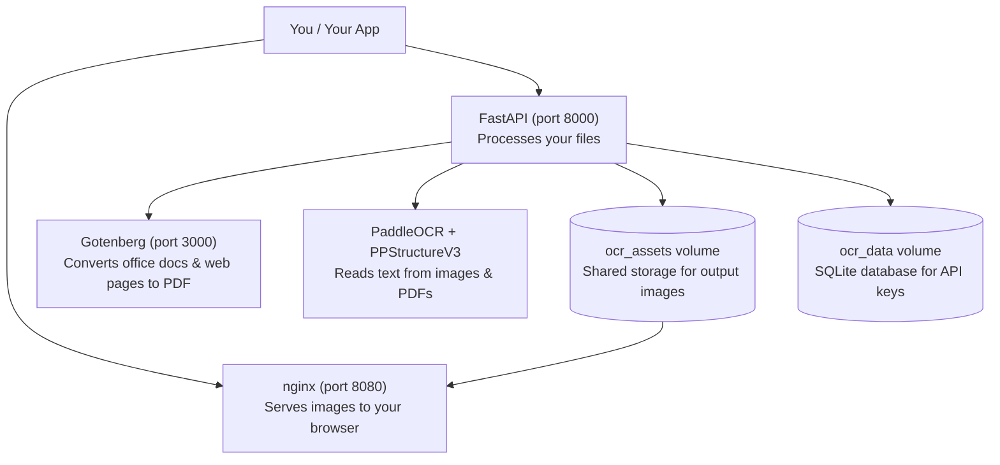

# Architecture Overview

## What This System Does

This is an internal OCR (Optical Character Recognition) pipeline. It takes images, PDFs, and office documents — then reads the text out of them.

If you have used Google Drive's "Open with Google Docs" feature on a scanned PDF, or Adobe Acrobat's "Export PDF" to extract text — this does the same thing. The difference: it runs on your own infrastructure, so your documents never leave your network.

## How the Services Fit Together

Three services work together inside Docker containers:



## What Each Service Does

### Gotenberg (document converter)

Gotenberg is an open-source tool (used by many companies) that wraps two conversion engines:

- **LibreOffice** — converts Word (DOCX), Excel (XLSX), PowerPoint (PPTX), and other office formats to PDF
- **Chromium** (the engine behind Google Chrome) — renders web pages and HTML files to PDF

This is the same approach used by cloud document services like Google Docs and Microsoft 365, but running locally on your machine.

### FastAPI (OCR processor)

This is the main application. It:

1. Receives your file upload and checks it is a supported type
2. Passes office documents and web pages to Gotenberg for PDF conversion
3. Sends images and PDFs to PaddleOCR — an open-source OCR engine developed by Baidu (one of the largest AI companies in the world)
4. Returns the extracted text as JSON, Markdown, or XML
5. Saves page images and markdown images to a shared storage volume

### nginx (image server)

A fast, lightweight web server that serves the images generated during OCR. By separating image serving from the main application, the OCR processor stays focused on what it does best — reading text — without the overhead of serving files to browsers.

This is the same pattern used by major platforms: AWS S3 serves images separately from EC2 compute instances.

### PaddleOCR (text recognition engine)

PaddleOCR is an open-source OCR toolkit from Baidu. It is one of the most accurate OCR engines available, regularly ranking at the top of benchmark comparisons against alternatives like:

- **Tesseract** (Google's OCR engine — industry standard for decades)
- **Azure OCR** (Microsoft's cloud OCR)
- **Amazon Textract** (AWS cloud OCR)

Being open-source and running locally means no per-document costs and no data leaving your infrastructure.

## Data Flow (Step by Step)

Here is what happens when you upload a file:

```
1. You upload image.png
       ↓
2. FastAPI checks: is this a valid file type? Is it under 50MB?
       ↓
3. (If office doc or URL) → Gotenberg converts to PDF
       ↓
4. PaddleOCR reads the image/PDF
       ↓
5. Text is extracted, page images are saved to shared volume
       ↓
6. FastAPI returns the text as JSON / Markdown / XML
       ↓
7. Your browser fetches page images from nginx (not FastAPI)
```

Step 4 is where the actual "reading" happens. PaddleOCR identifies text regions in the image, recognizes each character, and returns both the text and where it was found on the page (bounding box coordinates).

## Shared Storage

Output images are stored in a Docker named volume called `ocr_assets`. Both the FastAPI application (which writes images) and nginx (which serves images to your browser) access the same storage. This means:

- Images survive container restarts — if the application crashes mid-job, completed images are not lost
- The application and image server can be scaled independently if needed
- In the future, this volume could be replaced with Azure Blob Storage or another cloud service without changing the application code

## Security Considerations

- All API endpoints (except health checks) require an API key sent as an `X-API-Key` header
- URL endpoints block requests to internal network addresses (SSRF protection) — the same kind of protection used by cloud document converters
- Uploaded files are deleted immediately after processing — no permanent storage of source documents
- Output images expire after 1 hour (configurable) and are automatically cleaned up

## When to Use Each Processing Mode

| Mode | Use Case | Wait Time |
|---|---|---|
| **Sync** (`/ocr/parse`) | One file, need answer now | During processing (seconds to minutes) |
| **Background job** (`/ocr/parse/jobs`) | One file, don't want to wait | Poll for result later |
| **Batch** (`/ocr/parse/batch`) | Many files at once | Poll for results later |

## Project Origins and Feasibility

This pipeline uses proven, production-grade open-source components:

- **PaddleOCR** — used by Baidu and thousands of companies worldwide for document digitization
- **Gotenberg** — used by organizations like the French government and多家 enterprises for document conversion
- **FastAPI** — one of the fastest-growing Python web frameworks, used by companies like Uber, Netflix, and Microsoft
- **nginx** — serves over 30% of all websites on the internet

The architecture follows the same separation-of-concerns pattern used by cloud OCR services (AWS Textract, Google Cloud Vision, Azure Document Intelligence), but designed to run on your own infrastructure.
